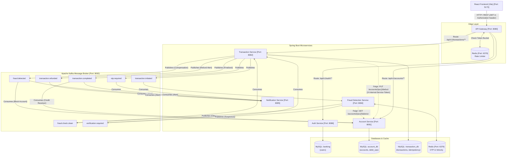
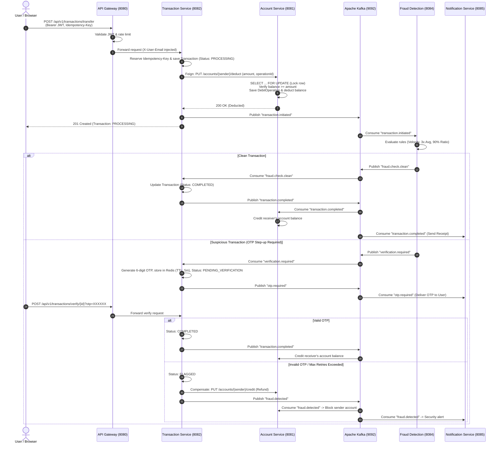

# TransMoney 💸

A distributed, event-driven digital banking and wallet microservices platform built with **Java 21/25**, **Spring Boot 4.x**, **Spring Cloud Gateway**, **Apache Kafka**, **Redis**, and **MySQL**, complemented by a responsive **React 19 + TypeScript + Vite** frontend.

---

## Table of Contents

- [1. Introduction](#1-introduction)
- [2. Project Status](#2-project-status)
- [3. Implemented Features](#3-implemented-features)
- [4. Technology Stack](#4-technology-stack)
- [5. System Architecture](#5-system-architecture)
- [6. Microservices Overview](#6-microservices-overview)
- [7. Money Transfer Lifecycle](#7-money-transfer-lifecycle)
- [8. Security Architecture](#8-security-architecture)
- [9. Prerequisites](#9-prerequisites)
- [10. Environment Configuration](#10-environment-configuration)
- [11. Installation and Local Setup](#11-installation-and-local-setup)
- [12. API Documentation](#12-api-documentation)
- [13. Example Transfer Workflow](#13-example-transfer-workflow)
- [14. Database Design](#14-database-design)
- [15. Testing and Quality Assurance](#15-testing-and-quality-assurance)
- [16. Known Limitations and Architectural Constraints](#16-known-limitations-and-architectural-constraints)
- [17. Project Structure](#17-project-structure)
- [18. Troubleshooting Guide](#18-troubleshooting-guide)
- [19. Future Improvements](#19-future-improvements)
- [20. Contribution, License, and Contact](#20-contribution-license-and-contact)

---

## 1. Introduction

**TransMoney** is a financial microservices platform designed to simulate modern retail banking operations: user registration, account lifecycle management, real-time balance tracking, and peer-to-peer fund transfers. The system showcases distributed systems patterns including API Gateway routing with rate limiting, pessimistic database row locking, idempotent transaction handling, asynchronous fraud evaluation via Apache Kafka, time-limited OTP step-up verification backed by Redis, and compensating transactions.

### Core Problem Solved
Traditional monolithic banking apps struggle with independent scaling of high-volume read paths (account balance lookups) and compute-heavy asynchronous operations (fraud rule analysis, event publishing, external notifications). TransMoney decouples user-facing transaction intake from fraud heuristics and asynchronous receiver settlements, ensuring transfer requests are acknowledged quickly while maintaining transactional safety boundaries.

---

## 2. Project Status

> [!IMPORTANT]
> **Development & Academic/Portfolio Notice:**  
> TransMoney is an active reference implementation and portfolio project. While core workflows (authentication, account isolation, debit idempotency, Kafka event orchestration, and fraud detection rules) are implemented and backed by regression tests, **it is not certified bank-grade production software**. Certain distributed systems constraints (such as an outbox pattern for Kafka publishing and two-phase receiver validation) remain documented architectural limitations.

---

## 3. Implemented Features

### Identity & Authentication
- **User Registration & Login:** Password hashing with `BCryptPasswordEncoder`, stateless authentication via JSON Web Tokens (JWT).
- **Email Resolution:** API Gateway validates JWT signatures and injects sanitized `X-User-Email` headers into internal downstream requests.

### Account Management
- **Digital Account Creation:** Supports `SAVINGS` and `CURRENT` account types tied to registered user identities.
- **Account Isolation:** Strict account ownership enforcement preventing cross-user account access.
- **Pessimistic Row-Level Locking:** Thread-safe balance deduction using MySQL `SELECT ... FOR UPDATE` (`findByAccountNumberForUpdate`), eliminating concurrency race conditions.

### Money Transfers & Idempotency
- **Transfer Initiation:** Client-supplied unique `Idempotency-Key` header mapped to database-level idempotency records.
- **Pessimistic Debit Idempotency:** Duplicate debit requests with the same `operationId` on an account return safely without deducting balances twice.
- **Review & Confirmation Workflow:** React frontend generates UUID idempotency keys per transfer form lifecycle to prevent double-submissions.

### Fraud Detection & Step-Up Verification
- **Velocity Rule:** Flags transfers exceeding 5 transactions per minute for a single account.
- **High-Value Multiplier:** Flags transfers whose amount exceeds 3x the account's historical average.
- **Balance Depletion Ratio:** Flags transfers attempting to move more than 90% of available account balance.
- **Redis-Backed OTP Flow:** Flags suspicious transfers into `PENDING_VERIFICATION`, publishes an `otp.required` event, and verifies 6-digit one-time passwords stored with 5-minute Redis TTL.
- **Compensating Refund:** Submitting an invalid OTP automatically cancels the transfer, triggers SAGA compensation to refund the sender's balance, and blocks the compromised account.

### Asynchronous Event Streaming & Notifications
- **Kafka Event Bus:** Decoupled topics (`transaction.initiated`, `fraud.check.clean`, `verification.required`, `otp.required`, `transaction.completed`, `fraud.detected`, `transaction.refunded`).
- **Simulated Notifications:** Consumer service processes Kafka alerts for OTP delivery, transaction completions, and fraud blocks.

---

## 4. Technology Stack

### Backend Services
| Component | Technology | Version | Description |
| :--- | :--- | :--- | :--- |
| **Runtime** | Java OpenJDK | 21 (LTS) / 25 | Language platform for microservices |
| **Framework** | Spring Boot | 4.1.1 | Application framework & dependency injection |
| **API Gateway** | Spring Cloud Gateway (WebFlux) | 2025.1.3 | Reactive reverse proxy, rate limiting, and JWT validation |
| **Inter-Service REST** | Spring Cloud OpenFeign | 4.1.x | Declarative HTTP client for internal service-to-service calls |
| **Persistence** | Spring Data JPA / Hibernate ORM | 7.0.x / 6.x | Entity mapping and repository abstraction |
| **Security** | Spring Security | 6.x | Filter chains, method security, and password encoders |
| **JWT** | `jjwt-api`, `jjwt-impl`, `jjwt-jackson` | 0.12.6 | Cryptographic signing and validation of tokens |

### Data, Messaging & Caching
| Component | Technology | Version / Image | Purpose |
| :--- | :--- | :--- | :--- |
| **Relational Databases** | MySQL | `8.0` (Docker) | ACID-compliant storage for users, accounts, and transactions |
| **In-Memory Cache** | Redis | `7` (Docker) | Gateway rate limiting counters and fraud OTP validation storage |
| **Event Streaming** | Apache Kafka | `7.5.0` (Confluent Docker) | Distributed asynchronous message broker |
| **Coordination** | Apache ZooKeeper | `7.5.0` (Confluent Docker) | Cluster management for Kafka broker |

### Frontend
| Component | Technology | Version | Description |
| :--- | :--- | :--- | :--- |
| **UI Framework** | React | 19.2.8 | Single-page application library |
| **Build Tool** | Vite | 8.3.0 | Modern ESM frontend bundler |
| **Type System** | TypeScript | ~6.0.2 | Strict-mode static typing |
| **Styling** | Tailwind CSS | 3.4.14 | Utility-first responsive styling |
| **State Management** | Zustand | 5.0.0 | Lightweight persisted client store |
| **Form Validation** | React Hook Form + Zod | 7.53.0 / 3.23.8 | Schema-based form validation |
| **HTTP Client** | Axios | 1.7.7 | Centralized API client with auth interceptors |
| **Linter** | Oxlint | 1.81.0 | High-performance Rust-based JavaScript/TypeScript linter |

---

## 5. System Architecture

The following diagram details the actual implemented services, ports, communication paths, and storage boundaries:



---

## 6. Microservices Overview

| Service Name | Directory | Local Port | Database / Storage | Key Responsibilities | Primary Routes / Prefix |
| :--- | :--- | :---: | :--- | :--- | :--- |
| **`api-gateway`** | `backend/api-gateway` | **`8080`** | Redis (`localhost:6379`) | Edge routing, JWT signature verification, CORS headers, Redis token-bucket rate limiting. | `/api/v1/**` |
| **`account-service`** | `backend/account-service` | **`8081`** | MySQL `account_db` | Account creation, balance retrieval, pessimistic debit idempotency, Kafka receiver crediting. | `/api/v1/accounts/**` |
| **`transaction-service`**| `backend/transaction-service`| **`8082`** | MySQL `transaction_db`, Redis | Transfer orchestration, idempotency key reservations, Kafka event publishing, OTP verification. | `/api/v1/transactions/**` |
| **`fraud-detection-service`** | `backend/fraud-detection-service` | **`8084`** | Redis (`localhost:6379`) | Real-time transaction fraud heuristic evaluation (velocity, ratio, multiplier) via Kafka streams. | *(Event-driven only)* |
| **`notification-service`** | `backend/notification-service` | **`8085`** | *(Console Logger)* | Asynchronous alert dispatch for OTP notifications, transfer confirmations, and fraud blocks. | *(Event-driven only)* |
| **`auth-service`** | `backend/auth-service` | **`8086`** | MySQL `banking` | User registration, password verification (`BCrypt`), JWT creation. | `/api/v1/auth/**` |
| **`frontend`** | `frontend` | **`5173`** | Browser `localStorage` | React UI: registration, login, dashboard, transfer wizard, OTP step-up verification, history. | `/dashboard`, `/transfer`, etc. |

---

## 7. Money Transfer Lifecycle

TransMoney implements a distributed, event-driven transfer flow using a choreographed SAGA with compensation.



### Important SAGA Limitations in Current Code
1. **Receiver Account Pre-Validation:** `TransactionService.transfer()` does not synchronously check if `receiverAccountNumber` exists before deducting the sender's balance. If a non-existent receiver account is submitted, the sender is deducted, the transaction marks `COMPLETED`, and the asynchronous consumer fails to find the receiver. *(See [Known Limitations](#16-known-limitations-and-architectural-constraints)).*
2. **Dual-Write Problem (Outbox Pattern):** Transaction status updates in MySQL and Kafka message publishing occur in sequence rather than atomically via a Transactional Outbox.

---

## 8. Security Architecture

### Authentication & Gateway Isolation
- **Stateless Tokens:** Signed using HMAC-SHA256 (`jjwt-api`). Passwords hashed with `BCryptPasswordEncoder`.
- **Gateway Boundary Defense:** Sensitive internal management endpoints (`/api/v1/accounts/*/credit`, `/deduct`, `/block`, `/balance`) are strictly blocked at the API Gateway level using `.denyAll()` route matchers in `SecurityConfig.java`. Ordinary external clients cannot call them directly.
- **Service-to-Service Authorization:** Internal endpoints in `account-service` require an `X-Internal-Service-Token` header mapped to `ROLE_INTERNAL_SERVICE`. Feign clients in `transaction-service` automatically inject this token via a `RequestInterceptor`.
- **Identity Spoofing Prevention:** The API Gateway validates incoming JWT tokens and replaces or injects the authentic subject into `X-User-Email`. Downstream services rely on the authenticated context or this gateway-filtered header.
- **IDOR Protection:** `TransactionController` and `AccountController` verify that the authenticated caller owns the target account before exposing transaction histories, account details, or allowing OTP verification.

---

## 9. Prerequisites

### Mandatory
- **Java Development Kit (JDK):** JDK 21 LTS or JDK 25.
- **Node.js & npm:** Node.js `v18+` (tested with `v22.18.0`, npm `10.9.3`).
- **Docker & Docker Compose:** Docker Engine `24+` / Docker Desktop.

### Optional
- **MySQL Client:** (e.g., MySQL Workbench, DBeaver) for inspecting local schemas.
- **Postman / Bruno / cURL:** For standalone API testing.

---

## 10. Environment Configuration

Spring Boot services consume environment variables from the host operating system. A safe template is provided in the repository root as [`.env.example`](file:///.env.example).

### Configuration Variables Reference

| Environment Variable | Required For | Default / Example Value | Purpose |
| :--- | :--- | :--- | :--- |
| `JWT_SECRET` | `api-gateway`, `auth-service` | `REPLACE_WITH_A_SECURE_256BIT_SECRET` | HMAC-SHA256 JWT signing secret key (minimum 32 characters). |
| `GATEWAY_AUTH_TOKEN` | `api-gateway`, `account-service`, `transaction-service` | `transmoney-local-dev-gateway-auth-token-2026` | Shared secret header validating gateway origin. |
| `INTERNAL_SERVICE_TOKEN` | `transaction-service`, `fraud-detection-service`, `account-service` | `transmoney-service-to-service-internal-token-2026` | Token for internal Feign service-to-service calls. |
| `MYSQL_ROOT_PASSWORD` | Docker, `account-service`, `transaction-service` | `root` | Root administrative password for MySQL container. |
| `MYSQL_PASSWORD` | Docker, `auth-service` | `banking` | Password for application user `banking`. |
| `AUTH_DB_URL` | `auth-service` | `jdbc:mysql://localhost:3306/banking` | JDBC URL for authentication database. |
| `ACCOUNT_DB_URL` | `account-service` | `jdbc:mysql://localhost:3306/account_db?createDatabaseIfNotExist=true` | JDBC URL for accounts database. |
| `TRANSACTION_DB_URL` | `transaction-service` | `jdbc:mysql://localhost:3306/transaction_db?createDatabaseIfNotExist=true` | JDBC URL for transactions database. |
| `REDIS_HOST` | `api-gateway`, `transaction-service`, `fraud-detection-service` | `localhost` | Redis host for rate limiting and OTP cache. |
| `REDIS_PORT` | `api-gateway`, `transaction-service`, `fraud-detection-service` | `6379` | Redis port. |
| `KAFKA_BOOTSTRAP_SERVERS`| All event-driven services | `localhost:9092` | Kafka broker host and port. |
| `VITE_API_BASE_URL` | `frontend` | `http://localhost:8080` | Target gateway URL for Axios HTTP requests. |

### Setting Environment Variables on Windows PowerShell

```powershell
$env:JWT_SECRET = "replace_with_a_secure_random_base64_or_alphanumeric_secret_key"
$env:MYSQL_ROOT_PASSWORD = "root"
$env:MYSQL_PASSWORD = "banking"
$env:GATEWAY_AUTH_TOKEN = "transmoney-local-dev-gateway-auth-token-2026"
$env:INTERNAL_SERVICE_TOKEN = "transmoney-service-to-service-internal-token-2026"
```

---

## 11. Installation and Local Setup

### Step 1: Clone the Repository
```bash
git clone https://github.com/your-username/transmoney-microservice.git
cd transmoney-microservice
```

### Step 2: Start Infrastructure Containers
Launch MySQL, Redis, Zookeeper, and Kafka using Docker Compose:
```powershell
cd backend
docker compose up -d
```
Verify all 4 containers are running:
```powershell
docker ps --format "table {{.Names}}\t{{.Status}}\t{{.Ports}}"
```

### Step 3: Initialize Databases
The databases `account_db` and `transaction_db` auto-create via JDBC connection parameters (`createDatabaseIfNotExist=true`). Ensure the `banking` database exists for `auth-service`:
```powershell
docker exec -i banking-mysql mysql -uroot -proot -e "CREATE DATABASE IF NOT EXISTS banking;"
```

### Step 4: Start Backend Services
Start each service in a separate PowerShell terminal window in the recommended startup order:

```powershell
# 1. Auth Service (Port: 8086)
cd backend/auth-service
.\mvnw.cmd spring-boot:run

# 2. Account Service (Port: 8081)
cd backend/account-service
.\mvnw.cmd spring-boot:run

# 3. Transaction Service (Port: 8082)
cd backend/transaction-service
.\mvnw.cmd spring-boot:run

# 4. Fraud Detection Service (Port: 8084)
cd backend/fraud-detection-service
.\mvnw.cmd spring-boot:run

# 5. Notification Service (Port: 8085)
cd backend/notification-service
.\mvnw.cmd spring-boot:run

# 6. API Gateway (Port: 8080)
cd backend/api-gateway
.\mvnw.cmd spring-boot:run
```

### Step 5: Start the Frontend Application
```powershell
cd frontend
npm install
npm run dev
```

### Step 6: Verify Service Health
Open your browser or run HTTP requests against Actuator health checks:
- API Gateway: `http://localhost:8080/actuator/health`
- Account Service: `http://localhost:8081/actuator/health`
- Transaction Service: `http://localhost:8082/actuator/health`
- Frontend Web UI: `http://localhost:5173`

---

## 12. API Documentation

> [!NOTE]
> Formal OpenAPI/Swagger UI endpoints are not currently bundled into the Maven build. The table below represents the verified REST endpoints implemented across the codebase.

### Public & User-Facing Endpoints (Via API Gateway `:8080`)

| Method | Endpoint | Description | Auth Required | Request Body / Parameters | Expected Status |
| :--- | :--- | :--- | :---: | :--- | :---: |
| `POST` | `/api/v1/auth/register` | Register a new user | Public | JSON: `name`, `email`, `password` | `200 OK` |
| `POST` | `/api/v1/auth/login` | Authenticate and obtain JWT | Public | JSON: `email`, `password` | `200 OK` (`token`) |
| `POST` | `/api/v1/accounts` | Create an account | Bearer JWT | JSON: `accountType`, `initialDeposit` | `201 Created` |
| `GET` | `/api/v1/accounts/{accountNumber}` | Get account details by account number | Bearer JWT | Path variable: `accountNumber` | `200 OK` / `403` |
| `GET` | `/api/v1/accounts/me` | Get current authenticated user's account | Bearer JWT | None (Uses token identity) | `200 OK` |
| `POST` | `/api/v1/transactions/transfer` | Initiate money transfer | Bearer JWT | Header: `Idempotency-Key`<br/>JSON: `senderAccountNumber`, `receiverAccountNumber`, `amount`, `description` | `201 Created` |
| `GET` | `/api/v1/transactions/{transactionId}` | Get transaction status | Bearer JWT | Path variable: `transactionId` | `200 OK` / `403` |
| `GET` | `/api/v1/transactions/account/{accountNumber}` | Get account transaction history | Bearer JWT | Path variable: `accountNumber` | `200 OK` / `403` |
| `POST` | `/api/v1/transactions/verify/{transactionId}` | Verify step-up OTP | Bearer JWT | Query param: `otp=XXXXXX` | `200 OK` / `400` / `403` |

### Internal Protected Endpoints (Direct Service `:8081`, Blocked at Gateway)

| Method | Direct Endpoint | Required Header | Purpose |
| :--- | :--- | :--- | :--- |
| `PUT` | `/api/v1/accounts/{acc}/deduct` | `X-Internal-Service-Token` | Deducts balance using pessimistic row locking during transfer SAGA Step 1. |
| `PUT` | `/api/v1/accounts/{acc}/credit` | `X-Internal-Service-Token` | Credits balance during SAGA settlement or refund compensation. |
| `PUT` | `/api/v1/accounts/{acc}/block` | `X-Internal-Service-Token` | Blocks an account when fraud is confirmed. |
| `GET` | `/api/v1/accounts/{acc}/balance`| `X-Internal-Service-Token` | Internal balance check for fraud evaluation. |

---

## 13. Example Transfer Workflow

### 1. Authenticate & Obtain JWT
```bash
curl -X POST http://localhost:8080/api/v1/auth/login \
  -H "Content-Type: application/json" \
  -d '{
    "email": "user@example.com",
    "password": "SecurePassword123!"
  }'
```
*Response:*
```json
{
  "token": "eyJhbGciOiJIUzI1NiIsInR5cCI6IkpXVCJ9.eyJzdWIiOiJ1c2VyQGV4YW1wbGUuY29tIiwiaWF0IjoxNzI5..."
}
```

### 2. Initiate Transfer with Idempotency Key
```bash
curl -X POST http://localhost:8080/api/v1/transactions/transfer \
  -H "Authorization: Bearer <YOUR_JWT_TOKEN>" \
  -H "Idempotency-Key: 9b1deb4d-3b7d-4bad-9bdd-2b0d7b3dcb6d" \
  -H "Content-Type: application/json" \
  -d '{
    "senderAccountNumber": "100000000001",
    "receiverAccountNumber": "100000000002",
    "amount": 1000.00,
    "description": "Invoice payment"
  }'
```
*Response (`201 Created`):*
```json
{
  "id": "e2a4a75e-5b12-4cf0-94d8-7928b5a1f0a2",
  "senderAccountNumber": "100000000001",
  "receiverAccountNumber": "100000000002",
  "amount": 1000.00,
  "status": "PROCESSING",
  "description": "Invoice payment",
  "createdAt": "2026-10-22T03:00:00"
}
```

### 3. Verify Step-Up OTP (If Flagged as `PENDING_VERIFICATION`)
```bash
curl -X POST "http://localhost:8080/api/v1/transactions/verify/e2a4a75e-5b12-4cf0-94d8-7928b5a1f0a2?otp=123456" \
  -H "Authorization: Bearer <YOUR_JWT_TOKEN>"
```

---

## 14. Database Design

TransMoney uses separate databases for domain boundaries. **Note on Ledger Architecture:** The project currently modifies balances via single-column mutations (`balance = balance - amount`). It is **not** a full double-entry ledger with debit/credit balance pairing.

### Database Schemas

#### 1. `banking` (`auth-service`)
- `users`: `id` (PK, auto-increment), `name` (VARCHAR), `email` (VARCHAR, unique), `password` (VARCHAR, BCrypt hash), `role` (VARCHAR), `created_at` (TIMESTAMP).

#### 2. `account_db` (`account-service`)
- `accounts`: `id` (PK, auto-increment), `account_number` (VARCHAR, unique), `user_id` (BIGINT), `email` (VARCHAR), `account_type` (VARCHAR: `SAVINGS`, `CURRENT`), `balance` (DECIMAL(19,2)), `status` (VARCHAR: `ACTIVE`, `BLOCKED`), `created_at` (TIMESTAMP).
- `debit_operations`: `id` (PK, auto-increment), `operation_id` (VARCHAR, unique), `account_number` (VARCHAR), `amount` (DECIMAL(19,2)), `created_at` (TIMESTAMP).

#### 3. `transaction_db` (`transaction-service`)
- `transactions`: `id` (PK, VARCHAR UUID), `sender_account_number` (VARCHAR), `receiver_account_number` (VARCHAR), `amount` (DECIMAL(19,2)), `status` (VARCHAR: `PROCESSING`, `COMPLETED`, `PENDING_VERIFICATION`, `FLAGGED`, `FAILED`, `REFUNDED`), `description` (VARCHAR), `created_at` (TIMESTAMP), `completed_at` (TIMESTAMP).
- `idempotency_records`: `id` (PK, auto-increment), `idempotency_key` (VARCHAR, unique), `account_number` (VARCHAR), `amount` (DECIMAL(19,2)), `status` (VARCHAR: `PROCESSING`, `COMPLETED`, `FAILED`), `transaction_id` (VARCHAR), `created_at` (TIMESTAMP).

---

## 15. Testing and Quality Assurance

### Automated Backend Maven Tests
Each backend microservice includes isolated unit and security regression test suites.
```powershell
# Run tests for each service
cd backend/api-gateway; .\mvnw.cmd test
cd ../auth-service; .\mvnw.cmd test
cd ../account-service; .\mvnw.cmd test
cd ../transaction-service; .\mvnw.cmd test
cd ../fraud-detection-service; .\mvnw.cmd test
cd ../notification-service; .\mvnw.cmd test
```

### Dedicated Security Test Suites
- **`AccountSecurityTest`** (`account-service`): 8 test cases verifying that internal credit, debit, block, and balance endpoints reject unauthorized calls without `ROLE_INTERNAL_SERVICE` (`403 Forbidden`).
- **`TransactionSecurityTest`** (`transaction-service`): 5 test cases verifying that transaction history, transaction lookup, and OTP verification enforce account ownership and reject cross-user access (`403 Forbidden`).

### Frontend Lint and Typecheck
```powershell
cd frontend
npm run lint    # Runs oxlint static analysis (0 errors)
npm run build   # Runs TypeScript strict compiler (tsc -b) & Vite build
```

---

## 16. Known Limitations and Architectural Constraints

TransMoney maintains an open record of architectural debt identified during testing audits:

1. **Receiver Account Verification:** The transaction intake flow does not perform a synchronous check to verify whether the receiver's account number exists in `account-service` before debiting the sender. If a non-existent receiver is provided, the sender is debited, and the asynchronous receiver-crediting Kafka consumer will fail.
2. **Dual-Write Consistency:** Services write to MySQL and publish to Kafka sequentially without a Transactional Outbox pattern. A network partition or JVM crash between the database write and Kafka dispatch can cause message loss.
3. **Idempotency Lifecycle & Edge Error Handling:** If a transfer request fails validation (such as omitting a mandatory description field), the idempotency reservation created in `Propagation.REQUIRES_NEW` may remain locked in `PROCESSING` status rather than being released or marked `FAILED`.
4. **Standardized Exception Formatting:** Several services lack centralized `@ControllerAdvice` handlers, returning generic 500 error traces instead of structured JSON problem details (`RFC 7807`).

---

## 17. Project Structure

```
transmoney-microservice/
├── .env.example                       # Root environment variables template
├── .gitignore                         # Root Git ignore rules
├── README.md                          # Project documentation
├── backend/                           # Spring Boot Microservices
│   ├── docker-compose.yml             # MySQL, Redis, Kafka, Zookeeper definitions
│   ├── api-gateway/                   # Spring Cloud Gateway (Port 8080)
│   ├── auth-service/                  # User Registration & JWT Authentication (Port 8086)
│   ├── account-service/               # Banking Accounts & Idempotent Debits (Port 8081)
│   ├── transaction-service/           # Transfer SAGA & Idempotency Orchestrator (Port 8082)
│   ├── fraud-detection-service/       # Kafka-based Fraud Rules Engine (Port 8084)
│   └── notification-service/          # Asynchronous Alert Simulator (Port 8085)
├── docs/                              # Architecture and Audit Reports
│   ├── testing/
│   │   ├── BUGS_AND_RISKS.md          # Complete vulnerability register
│   │   ├── COMPREHENSIVE_TEST_REPORT.md # E2E testing execution results
│   │   ├── TESTING_GUIDE.md           # Local test isolation procedure
│   │   └── TEST_CASES.md              # Functional & concurrency test matrices
├── frontend/                          # React + TypeScript + Vite SPA
│   ├── .env.example                   # Frontend environment template
│   ├── package.json                   # Dependencies and scripts
│   ├── vite.config.ts                 # Vite bundler configuration
│   └── src/
│       ├── api/                       # Axios HTTP client & interceptors
│       ├── features/                  # Domain components (auth, accounts, transfers)
│       └── layouts/                   # Protected and Public page layouts
```

---

## 18. Troubleshooting Guide

### 1. Port 8080/8081/8082 Already in Use
Check which process is listening on the conflicting port:
```powershell
Get-NetTCPConnection -LocalPort 8080, 8081, 8082 -ErrorAction SilentlyContinue | Select-Object LocalPort, OwningProcess
```
Terminate the conflicting process by PID:
```powershell
Stop-Process -Id <PID> -Force
```

### 2. MySQL Connection Refused (`Communications link failure`)
Ensure the Docker container is up and running healthy:
```powershell
docker ps --filter "name=banking-mysql"
docker logs banking-mysql --tail 20
```

### 3. Kafka Broker Not Available (`Broker: Node -1 disconnected`)
Zookeeper must fully initialize before Kafka starts. If Kafka exits unexpectedly, restart it:
```powershell
docker restart banking-zookeeper
Start-Sleep -Seconds 5
docker restart banking-kafka
```

### 4. JWT Validation Fails Across Gateway and Services
Ensure the exact same `JWT_SECRET` is supplied to both `api-gateway` and `auth-service`. A mismatch will cause the Gateway to return `401 Unauthorized` for tokens issued by `auth-service`.

---

## 19. Future Improvements

- [ ] **Transactional Outbox Pattern:** Implement Debezium or Spring CDC Outbox to ensure zero message loss between database transactions and Kafka events.
- [ ] **Synchronous Receiver Verification:** Add Feign pre-flight check in `transaction-service` to validate the receiver account before sender debit execution.
- [ ] **Double-Entry General Ledger:** Replace direct balance mutations with double-entry journal entries (debits and credits) and an immutable transaction ledger.
- [ ] **OpenAPI / Swagger Integration:** Bundle `springdoc-openapi-starter-webmvc-ui` for live interactive documentation.
- [ ] **Mutual TLS (mTLS):** Enforce cryptographic service identity across internal microservice communication.

---

## 20. Contribution, License, and Contact

### Contributing
Contributions, bug reports, and suggestions are welcome.
1. Fork the repository.
2. Create a feature branch (`git checkout -b feature/improvement`).
3. Commit your changes with clear messages (`git commit -m "feat: add receiver pre-validation"`).
4. Ensure all backend tests (`.\mvnw test`) and frontend checks (`npm run lint`, `npm run build`) pass.
5. Open a Pull Request.

### License
This project is currently distributed as an educational reference and portfolio architecture. Please consult the maintainer before using it for commercial purposes.

### Author & Contact
- **Author:** Shehzad Nisar  
- **Email:** `shehzadnisar07@gmail.com`  
- **Repository:** [transmoney-microservice](https://github.com/Shehzad-Nisar/transmoney-microservice)
